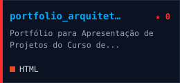
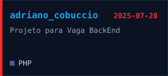
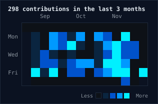

### 📌 Projetos Populares

<!-- TOP_REPOS_START -->

  
  
  

<!-- TOP_REPOS_END -->

---

### 🧠 Sobre IA & seu Propósito
Acredito que a Inteligência Artificial deve ser um meio, não um fim. O propósito da IA é automatizar a mineração e o processamento de dados para amplificar a capacidade humana — como uma aranha tecendo conexões invisíveis de conhecimento. Ela deve libertar mentes para o trabalho criativo, não substituí-las. No desenvolvimento e na ciência de dados, a IA é uma ferramenta de escala para que possamos construir o amanhã, hoje.

---

### 📊 Atividade (Últimos 3 Meses)

  

